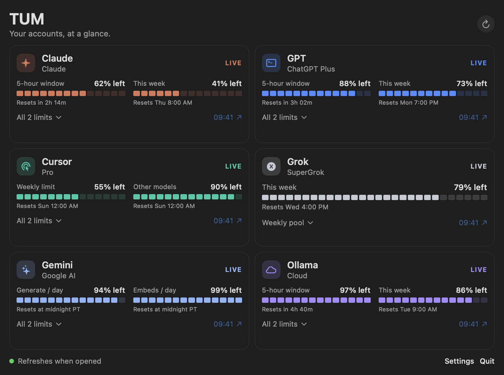

# Token Usage Monitor (TUM)

A Mac menu bar app that shows how much of each AI plan you have left.



*Screenshot uses sample numbers.*

TUM is a free, open-source app from [Skeptacular Apps](https://skeptacularapps.com).

## What it shows

- Grok, Claude, ChatGPT (Codex), Cursor, and Ollama Cloud, using the logins those tools already keep on your Mac.
- Gemini, Cerebras, Amazon Bedrock, and Vercel AI Gateway, if you turn them on and point them at your own project or account in Settings. They are off by default.
- A share button that copies a picture of your meters. It leaves out emails, account IDs, dollar amounts, and tokens unless you turn those on.
- Machines you can reach with SSH. The card shows the model loaded on each one and how much memory that model is using. Off until you add hosts in Settings.

## Build and run

You need macOS 14 or later and Swift 6 (Xcode 16 or the Swift toolchain).

```bash
git clone https://github.com/mskepner88/token-usage-monitor.git
cd token-usage-monitor
./scripts/run.sh
```

To build the app bundle without opening it:

```bash
./scripts/package-app.sh
open "dist/Token Usage Monitor.app"
```

Run the tests:

```bash
swift test
```

Open **Settings** from the menu bar popover to turn services on or off, change their order, and add your own paths or accounts. An example config is in [`config.example.json`](config.example.json).

Settings are saved in `~/Library/Application Support/TokenUsageMonitor/`. Pasted cookies and keys go in a local `secrets.json` there, or in the Keychain if you choose that in Settings.

## iPhone widget (free)

See your meters on your iPhone Home Screen and Lock Screen. It uses the free Scriptable app, needs no paid Apple account, and works through your own iCloud. Nothing goes to a server.

1. **Install Scriptable.** Get [Scriptable](https://apps.apple.com/app/scriptable/id1405459188) (free) from the App Store on your iPhone and open it once. Make sure iCloud Drive is on for Scriptable, on both your iPhone and your Mac (same Apple Account).
2. **Turn on the setting in Token Usage Monitor.** On your Mac, open **Settings** from the menu bar popover and turn on **Write a snapshot for the iPhone widget**. After each refresh, Token Usage Monitor saves `tum-snapshot.json` to Scriptable's iCloud folder (`~/Library/Mobile Documents/iCloud~dk~simonbs~Scriptable/Documents/`). The file holds service names, plans, percentages, and reset times only. No tokens, cookies, emails, or account IDs.
3. **Copy in the script.** In Scriptable, tap **+**, paste the contents of [`widgets/scriptable/token-usage-monitor.js`](widgets/scriptable/token-usage-monitor.js), name it **Token Usage Monitor**, and tap **Done**. Tap the script once to preview it.
4. **Add the widget.** Touch and hold your Home Screen, tap **Edit** › **Add Widget**, pick **Scriptable**, and choose the small or medium size. Touch and hold the new widget, tap **Edit Widget**, and set **Script** to **Token Usage Monitor**. To show only some services, type their names in **Parameter**, for example `Claude, Cursor`.
5. **Lock Screen setup.** Touch and hold your Lock Screen, tap **Customize** › **Lock Screen**, tap the widget area, and add **Scriptable** (the rectangular or inline one). Tap it and set **Script** to **Token Usage Monitor**.

Good to know:

- The widget shows how long ago the numbers were saved, for example "Updated 5m ago". If they are more than 30 minutes old (your Mac is asleep or off), it shows a grey **Stale** label.
- iOS decides how often widgets refresh, usually every 15 minutes or so.
- If Scriptable's folder isn't on your Mac yet, Token Usage Monitor writes to iCloud Drive › `TokenUsageMonitor/tum-snapshot.json` instead. To use that copy, in Scriptable open **Settings** › **File Bookmarks**, add a bookmark to that `TokenUsageMonitor` folder, and name it `TokenUsageMonitor`. Or open Scriptable on your iPhone once so its folder syncs, and the next refresh will write there.
- Test the widget logic on any computer with Node: `node --test widgets/scriptable/test`.

## Privacy

- Local-first. Everything runs on your Mac.
- No telemetry, no analytics, no TUM server.
- Your logins and keys are only sent to the service they belong to, to read your usage.

## Notes

Some services don't have an official way to read usage, so a meter may stop working when they change things. The card shows an error when that happens. TUM is not affiliated with any of the services it reads.

Release and packaging notes are in [docs/RELEASING.md](docs/RELEASING.md).

## License

MIT. See [LICENSE](LICENSE).

Website: [skeptacularapps.com](https://skeptacularapps.com)
